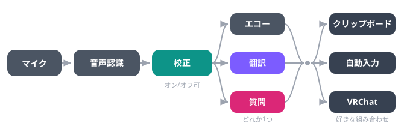

<p align="center">
  
  &nbsp;&nbsp;&nbsp;
  
</p>

# voxtype (PC) + VRC Companion (SteamVR)

タイピング無しで音声入力・翻訳・校正できる PC ツール。SteamVR オーバーレイ (VRC Companion) で VR の中からも操作できる

- **voxtype**: PC 側の常駐ツール。音声認識したテキストを校正・翻訳・質問応答してから好きな場所に出力する
- **VRC Companion**: SteamVR 側のオーバーレイ。voxtype を VR の中から操作する

## 機能

- 🎙 音声認識 (xAI Speech-to-Text による日本語ストリーミング認識)
- 🧹 校正: フィラー除去・言い間違い修正
- 🌐 翻訳 / 🤖 質問: エコー(そのまま)・翻訳・質問は排他のモードで切り替え
- 📋 クリップボードへコピー / ⌨️ アクティブウィンドウへ自動入力 / 💬 VRChat チャットボックスへ送信 (OSC)
- 📝 QvPen 呼び出しボタン

出力フォーマットなどの細かい挙動は設定画面から変えられます。

## 必要なもの

- [xAI API Key](https://x.ai/) — 音声認識と Grok (校正・翻訳・質問) に使用
- VRChat (OSC を有効にしておくこと)

## セットアップ

1. アプリを起動して右上の「⚙ 設定」を開く
2. xAI API キーを入力して保存する

設定は `%APPDATA%\vrc-companion\config.json` (Windows) に保存されます。

## 使い方

1. 「録音」ボタン、またはグローバルショートカットキー (既定 F9) で録音開始。無音が続くと自動で録音停止して結果が確定します
2. 送り先 (クリップボード / 自動入力 / VRChat) とモード (エコー / 翻訳 / 質問) を選ぶ
3. 「📝 QvPen を呼ぶ」で QvPen を呼び出せます

処理の流れ:

<p align="center">
  
</p>

## SteamVR オーバーレイ

SteamVR のダッシュボードに「VRC Companion」のタブが出て、録音の開始・停止、送り先・モードの切り替え、QvPen の呼び出しが VR の中からできます。

SteamVR はあとから起動しても自動でつながります。SteamVR を終了してもアプリは動いたままで、次に起動したときまたつながります。

パネル右端の丸いボタン A/B/X/Y はアバターのパラメーターをオン/オフするボタンです。設定の「VR のボタン A/B/X/Y の設定…」でパラメーター名と値を決めてください。

## コントローラーのボタンで操作する

SteamVR のボタン割り当て機能で、「録音を開始」「録音の開始/停止」「QvPen を呼ぶ」をコントローラーの好きなボタンに割り当てられます。はじめは、左の十字キー下 (Steam Frame)、左 A (Index)、左 X (Quest) の2回押しが録音開始です。割り当て画面は VR のタブか設定画面の「キー割り当て変更」から開けます。

## ビルド

```sh
make build   # Windows 用リリースビルド (x86_64-pc-windows-gnu)
make test    # テスト実行
```

詳細は `Makefile` を参照してください。
